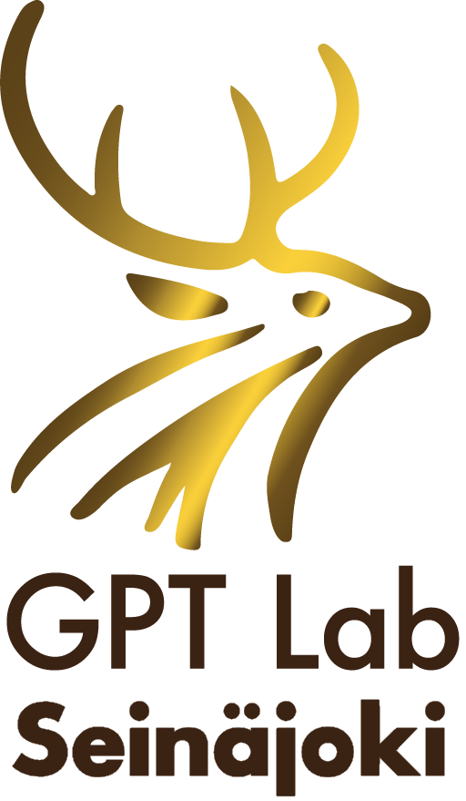

# GPT Lab Seinäjoki

**This project under the GPT Lab Seinäjoki program supports the regional strategy of fostering an innovative ecosystem and advancing smart, skilled development. Its goal is to introduce new AI knowledge and technology to the region, enhance research and innovation activities, and improve business productivity.**

## Setup

1. Install the dependencies: `pip install -r requirements.txt` (Python 3.11; Docker with Compose V2 must be installed).
2. Create a `.env` file with `OPENAI_API_KEY`.
3. Start the app: `chainlit run main.py`.

Optional settings in `.env`:

| Variable | Default | Purpose |
|---|---|---|
| `LLM_MODEL` | `gpt-4o-mini` | model of the analysis, Docker files and report agents |
| `LLM_CODE_MODEL` | `gpt-4o` | model of the agents that write and fix programs |
| `LLM_CODE_MAX_TOKENS` | `16384` | output cap of the code model; a whole program comes back in one reply |
| `LLM_CODE_TEMPERATURE` | `0` | set it empty for reasoning models, which accept only their default temperature |
| `OPENAI_API_BASE` | OpenAI | an OpenAI-compatible endpoint, e.g. Azure OpenAI (`https://<resource>.openai.azure.com/openai/v1`) |
| `CLAUDE_API_KEY` | – | only needed for the (currently unused) Claude client |
